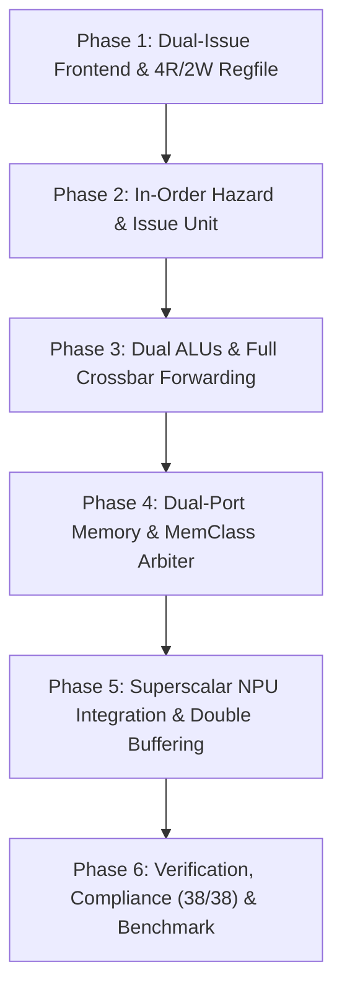

# Architectural Plan: In-Order Superscalar RV32I Core & Accelerated NPU Integration

> **Target Architecture:** Dual-Issue (2-Way) In-Order Superscalar RISC-V Processor with Concurrent NPU Coprocessor  
> **Repository:** `riscv-ai-accelerator`  
> **Source Baseline Reference:** `RISCV_CPU` (C++ behavioral superscalar model, `docs/superscalar.md`, `docs/superscalar-progress.md`)  
> **Hardware Target:** SystemVerilog RTL synthesizable for FPGA / ASIC, cycle-accurate Verilator co-simulation  

---

## Table of Contents
1. [Executive Summary & Motivation](#1-executive-summary--motivation)
2. [Key Insights & Lessons from `RISCV_CPU`](#2-key-insights--lessons-from-riscv_cpu)
   - 2.1 The 6-Stage Superscalar Execution Model
   - 2.2 Hazard Resolution Rules (`RAW`, `WAW`, `WAR`, `Control`, `MemClass`)
   - 2.3 Empirical Findings: The $n=2$ vs. $n=4$ Issue Width Trade-Off
   - 2.4 The Pointer-Arithmetic RAW Hazard Bottleneck
3. [Superscalar CPU Microarchitecture Design (RTL)](#3-superscalar-cpu-microarchitecture-design-rtl)
   - 3.1 Pipeline Organization: 2-Way Dual-Issue In-Order Datapath
   - 3.2 Stage-by-Stage Detailed Specification
     - IF Stage: 64-bit Fetch, Alignment Logic & BTB Speculation
     - ID Stage: Dual Decoders, 4R/2W Register File & Dynamic Issue Unit
     - EX Stage: Dual ALUs, Branch Evaluation & Full Crossbar Forwarding
     - MEM Stage: Memory Class Arbiter & Dual-Port Access
     - WB Stage: Dual Writeback with WAW Priority Arbitration
   - 3.3 Complete Superscalar Pipeline Block Diagram
4. [Superscalar NPU Accelerator Architecture](#4-superscalar-npu-accelerator-architecture)
   - 4.1 Concurrent Multi-Bank MMIO Access (`load_a` + `load_b` Co-Issue)
   - 4.2 Decoupled Asynchronous Execution & Non-Blocking Command Queuing
   - 4.3 Ping-Pong Double Buffering for Overlapped Tile Transfers & MAC Compute
   - 4.4 Co-Issuing Address Pointer Arithmetic with NPU Stream Operations
5. [Comprehensive System Block Diagram](#5-comprehensive-system-block-diagram)
6. [Detailed 6-Phase Implementation Roadmap](#6-detailed-6-phase-implementation-roadmap)
   - Phase 1: Dual-Issue Frontend & 4R/2W Register File
   - Phase 2: Dynamic Hazard & Issue Detection Unit (`hazard_unit_superscalar.sv`)
   - Phase 3: Dual Execution Datapath & Full Crossbar Forwarding Network
   - Phase 4: Dual-Bank Memory Subsystem & Memory Class Bus Arbiter
   - Phase 5: Concurrent Double-Buffered NPU Accelerator Integration
   - Phase 6: System Verification, Regression Suite & GEMM Benchmark
7. [Hardware Resource, Timing & Area Analysis](#7-hardware-resource-timing--area-analysis)
8. [Risk Assessment, Corner Cases & Mitigation Strategies](#8-risk-assessment-corner-cases--mitigation-strategies)

---

## 1. Executive Summary & Motivation

The `riscv-ai-accelerator` repository currently features:
1. A **single-issue 5-stage pipelined RV32I core** (`rtl/rv32i_pipelined/` and `rtl/rv32i_pipelined_stallbranch/`) achieving 100% compliance (38/38 PASS) on official `riscv-arch-test` suites.
2. An integrated **MMIO Neural Processing Unit (NPU)** coprocessor (`converting_into_NPU/rtl/npu_top.sv`) capable of computing $16 \times 16$ tile matrix multiplications in hardware, yielding an **8.3x end-to-end full-system speedup** over scalar software execution for $32 \times 32$ tiled GEMM.

Despite this speedup, the single-issue scalar pipeline acts as a severe throughput bottleneck during accelerator execution:
- Over **80% of total cycles** in tiled GEMM are spent by the CPU calculating base addresses, striding array pointers, looping over induction variables, and streaming data across the memory bus.
- In scalar execution, every address increment (`addi`, `add`), tile transfer instruction, status check, and loop branch (`bne`) must execute in sequential clock cycles, capping the CPU execution throughput at **IPC $\le 1.0$**.

By transitioning both the **CPU core** and the **NPU accelerator** into a **Superscalar architecture**, we enable multiple instructions to fetch, decode, issue, execute, and write back in parallel every single cycle (targeting **IPC up to 2.0** on dual-issue).

---

## 2. Key Insights & Lessons from `RISCV_CPU`

The software behavioral emulator in `/home/enovo/RISCV_CPU` provides empirical validation, hazard models, and quantitative performance sweeps (`docs/superscalar.md`, `docs/superscalar-progress.md`, `single_core_hardware_assumptions.md`).

### 2.1 The 6-Stage Superscalar Execution Model
`RISCV_CPU` models a classic first-generation in-order superscalar processor via six discrete methods per cycle:
```text
cpu.fetch_n();      // 1. Fetches issueWidth (n) consecutive 32-bit words
cpu.decode_all();   // 2. Parallel decode & control signal extraction for all slots
cpu.hazard_scan();  // 3. Dynamic scan: selects largest safe prefix m <= n to issue
cpu.execute_m();    // 4. Parallel execution of slots 0..m-1 across functional units
cpu.read_m();       // 5. Memory load/store/NPU dispatch for slots 0..m-1
cpu.writeback_m();  // 6. Commits slots 0..m-1 in program order; PC += 4 * m
```

### 2.2 Hazard Resolution Rules
The `hazard_scan()` logic defines exact criteria for safe parallel co-issue:

1. **RAW (Read-After-Write) Hazards**:
   - Instruction $i$ cannot co-issue with earlier instruction $j < i$ if $i$ reads a register ($rs1$ or $rs2$) that $j$ writes ($rd$).
   - In `RISCV_CPU` (which lacks intra-cycle forwarding), the issue window immediately truncates at $i$ ($m = i$), deferring instruction $i$ to the next clock cycle.
2. **WAW (Write-After-Write) Hazards**:
   - Handled naturally in program order: when two instructions in the same window write to the same register $rd$, the later slot's commit overwrites the earlier slot (`writeback_m()`).
   - In hardware RTL, this translates to **age-based write port priority arbitration**.
3. **WAR (Write-After-Read) Hazards**:
   - Avoided naturally because register reads occur before any register write lands at the clock edge.
4. **Control Hazards (Branches & Jumps) & "Branch Ends Issue Packet" Rule**:
   - Jumps (`JAL`, `JALR`) truncate the issue window at the jump instruction ($m = i + 1$).
   - **Branch-at-Slot-0 Truncation**: Any branch in Slot 0 immediately terminates the issue packet ($m = 1$). Slot 1 ($PC+4$) is unconditionally squashed to a hardware NOP (`32'h00000013`, `valid = 0`). This battle-tested rule:
     1. Enables single-ported BTB lookups (saving area and power).
     2. Eliminates speculative recovery and state hazard logic for Slot 1.
     3. Shortens the critical path to maximize $F_{max}$.
     4. Imposes virtually zero penalty in AI/matrix kernels (loop branches are taken >95% of the time).
   - Branches utilize a **128-entry Branch Target Buffer (BTB)** with **2-bit saturating counters** for zero-bubble speculative redirection. If mispredicted in EX, pipeline stages are flushed with high priority.
5. **Memory & Structural Hazards (`MemClass`)**:
   - Instructions are categorized into memory classes:
     - `MEM_NONE`: Pure ALU / branch ops; consume zero memory resources and never conflict with anything.
     - `MEM_STORE`: Scalar stores (`SW`) and NPU tile stores (`store_c`).
     - `MEM_BANK_A`: NPU Matrix A SRAM loads (`load_a`).
     - `MEM_BANK_B`: NPU Matrix B SRAM loads (`load_b`).
   - **Conflict Rule:** Two instructions conflict **if and only if they share the exact same non-`MEM_NONE` class**:
     $$\text{Conflict} \iff (\text{class}_A == \text{class}_B) \land (\text{class}_A \neq \text{MEM\_NONE})$$
   - Two stores conflict (single external memory write port).
   - Two loads to the same NPU bank conflict (single write port per bank).
   - **Crucial insight**: A store and an NPU bank load **do NOT conflict** (they use different physical interfaces: CPU store writes external RAM; NPU load reads external RAM and writes internal SRAM).
   - `load_a` and `load_b` **do NOT conflict** (they write to physically distinct SRAM banks).

### 2.3 Empirical Findings: The $n=2$ vs. $n=4$ Issue Width Trade-Off
From `RISCV_CPU/docs/superscalar-progress.md` (§6d, full 256×256 tiled GEMM sweep):

| Issue Width $n$ | Cycles (O2) | Speedup vs. Scalar | Marginal Gain |
|:---:|:---:|:---:|:---:|
| **Scalar ($n=1$)** | 26,763 | 1.000x | Baseline |
| **Dual-Issue ($n=2$)** | 13,641 | **1.962x** | **+96.2%** |
| **Triple-Issue ($n=3$)** | 13,123 | 2.039x | +3.8% |
| **Quad-Issue ($n=4$)** | 9,026 | 2.965x | +45.4% (with unrolling) |
| **Hex-Issue ($n=6$)** | 9,023 | 2.966x | +0.03% |
| **Deca-Issue ($n=10$)** | 9,022 | 2.966x | +0.00% |

**Key Takeaways for Hardware Synthesis:**
1. **$n=2$ (Dual-Issue)** captures **almost 2x speedup** with minimal hardware overhead: only 2 execution pipes, 4 read ports / 2 write ports on the register file, and simple bypass muxes.
2. **Widening past $n=4$ yields near-zero returns**: $n=6$ and $n=10$ produce identical cycle counts (9,023 vs 9,022 cycles) while quadratic wiring and multiplexing complexity explodes ($\mathcal{O}(n^2)$).
3. **Recommendation**: Implement a **2-Way (Dual-Issue) In-Order Superscalar Core** as the primary synthesis and tape-out target, architected cleanly with parameterized support for 4-way expansion.

### 2.4 The Pointer-Arithmetic RAW Hazard Bottleneck
In `RISCV_CPU`, loop unrolling experiments revealed that cycle count hit a hard floor (~9,000 cycles at O2) because address pointers were computed immediately before being consumed:
```assembly
add  a4, a4, a0    # Computes address for load_a (writes a4)
load_a a4          # Consumes a4 (RAW dependency!)
```
In a processor without intra-cycle ALU-to-ALU forwarding, `load_a` is forced to wait for the subsequent cycle. **In our RTL design, we will address this by implementing intra-cycle cross-pipe forwarding (EX0 $\to$ EX1 and EX0 $\to$ MEM1)** to break through this latency floor!

---

## 3. Superscalar CPU Microarchitecture Design (RTL)

We propose a **2-Way In-Order Dual-Issue 5-Stage Superscalar Core** (`rv32i_superscalar_core.sv`) consisting of Pipe 0 (Slot 0) and Pipe 1 (Slot 1).

```
Instruction Stream:  [ Slot 0 (Even/Lead) ]    |    [ Slot 1 (Odd/Trail) ]
Pipeline 0:          IF0 -> ID0 -> EX0 -> MEM0 -> WB0
Pipeline 1:          IF1 -> ID1 -> EX1 -> MEM1 -> WB1
```

### 3.1 Pipeline Organization & Co-Issue Matrix

| Feature | Pipeline 0 (Slot 0) | Pipeline 1 (Slot 1) |
|---|---|---|
| **Instruction Types Supported** | All RV32I (ALU, Branch, Jump, Load, Store, MMIO) | All RV32I ALU, Loads, Stores (Branches/Jumps optional/secondary) |
| **ALU Capabilities** | Full 32-bit ALU + Comparison Unit | Full 32-bit ALU |
| **Branch / Jump Evaluation** | Primary Branch Resolution & Target Generation | Secondary Branch Evaluation (or defer to Pipe 0) |
| **Memory Port Access** | Primary Port (Port 0) | Secondary Port (Port 1) |
| **Priority in WAW** | Lower priority (earlier in program order) | **Higher priority** (later in program order overwrites) |

---

### 3.2 Stage-by-Stage Detailed Specification

#### 1. Instruction Fetch Stage (IF)
- **64-bit Wide Fetch Bus**: IMEM returns two contiguous 32-bit words every cycle: `imem_data[63:0]` (`instr0` = bits 31:0, `instr1` = bits 63:32).
- **PC Alignment & Dynamic Packet Steer**:
  - If `pc[2] == 0` (64-bit aligned): `slot0_instr = imem_data[31:0]`, `slot1_instr = imem_data[63:32]`.
  - If `pc[2] == 1` (word unaligned, e.g. branch landed on odd word): `slot0_instr = imem_data[63:32]`, `slot1_instr = 32'h00000013` (NOP). Only 1 instruction issues; PC advances by +4 to re-align on 64-bit boundary.
- **Branch-at-Slot-0 Truncation (Branch Ends Issue Packet)**:
  - If `slot0` is ANY branch opcode (`7'b1100011`) or unconditional jump (`JAL`/`JALR`): `slot1_instr = 32'h00000013` (hardware NOP) and `slot1_valid = 1'b0`. Slot 0 issues alone (`issue_count = 1`).
- **PC Update Logic**:
  $$\text{next\_pc} = \begin{cases} 
  \text{ex\_branch\_target} & \text{if branch/jump taken in EX} \\
  \text{btb\_predicted\_target} & \text{if branch predicted taken in IF} \\
  \text{pc} + 8 & \text{if 2 instructions issued} \\
  \text{pc} + 4 & \text{if 1 instruction issued (or unaligned, or Slot 0 branch)} \\
  \text{pc} & \text{if stalled}
  \end{cases}$$
- **Branch Target Buffer (BTB)**:
  - 128-entry direct-mapped cache storing `{valid, tag[19:0], target_pc[31:0], 2-bit counter}`.
  - Predicts branch direction with zero bubble cycles.

#### 2. Instruction Decode Stage (ID) & Dynamic Issue Unit
- **Dual Decoders**: Instantiate two identical combinational decoders: `decoder0` and `decoder1` extracting `opcode`, `rd`, `rs1`, `rs2`, `funct3`, `funct7`, and immediate formats.
- **Register File with 4 Read Ports & 2 Write Ports (`register_file_4r2w.sv`)**:
  - `rs1_data0`, `rs2_data0` for Slot 0.
  - `rs1_data1`, `rs2_data1` for Slot 1.
  - `rd_data0` from WB0, `rd_data1` from WB1.
  - **Internal Write-to-Read Bypassing**: If either write port is writing to a register currently being read, forwarded synchronously within the same cycle.
- **Dynamic Issue & Hazard Unit (`hazard_unit_superscalar.sv`)**:
  Determines whether Slot 1 can issue alongside Slot 0 ($m = 2$) or must be stalled ($m = 1$):
  1. **Intra-Packet RAW Check**:
     ```systemverilog
     logic raw_hazard_0_to_1;
     assign raw_hazard_0_to_1 = id_reg_write0 && (id_rd0 != 5'd0) &&
                                ((id_uses_rs1_1 && (id_rs1_1 == id_rd0)) ||
                                 (id_uses_rs2_1 && (id_rs2_1 == id_rd0)));
     ```
     - *Design Choice A (Classic In-Order):* If `raw_hazard_0_to_1` is true, Slot 1 is held in ID; Slot 0 advances alone ($m = 1$).
     - *Design Choice B (Aggressive Bypass):* If Slot 0 is an ALU instruction and Slot 1 is an ALU instruction, forward EX0 ALU result directly into EX1 ALU input!
  2. **Control Hazard**: If Slot 0 is an unconditional jump (`JAL`, `JALR`), Slot 1 cannot issue ($m = 1$). If Slot 0 is a branch, Slot 1 issues only under branch prediction.
  3. **Structural / Memory Hazard**: If both Slot 0 and Slot 1 require memory access, check whether dual-port memory permits concurrent execution (see Section 3.2.4).
  4. **Load-Use Hazard Detection**: If an instruction in EX is a load (`mem_read == 1`) and either ID0 or ID1 consumes its destination, insert a 1-cycle pipeline bubble.

#### 3. Execution Stage (EX) & Forwarding Network
- **Dual ALUs**: `alu0` (Pipe 0) and `alu1` (Pipe 1) execute in parallel.
- **Branch Evaluation Unit in EX0**:
  - Evaluates branch condition and calculates resolved target address.
  - On mispredict: asserts `pipeline_flush`, updates BTB counter, and redirects PC to correct target.
- **Full Crossbar Forwarding Matrix**:
  Each of the 4 operands (`alu0_opA`, `alu0_opB`, `alu1_opA`, `alu1_opB`) can source from:
  - Register File read data (default)
  - `ex_mem0_alu_result` (EX0 $\to$ EX)
  - `ex_mem1_alu_result` (EX1 $\to$ EX)
  - `mem_wb0_write_data` (MEM0 $\to$ EX)
  - `mem_wb1_write_data` (MEM1 $\to$ EX)
  - `ex0_alu_result` (Intra-cycle EX0 $\to$ EX1 for back-to-back ALU co-issue!)

#### 4. Memory Access Stage (MEM) & Arbiter
- **Dual-Port Memory Controller (`data_memory_dualport.sv`)**:
  - Port 0 connected to Pipe 0; Port 1 connected to Pipe 1.
  - **Memory Class Hazard Arbiter**:
    - `MEM_STORE` + `MEM_STORE` $\to$ Serialize (Port 0 completes in cycle $T$, Port 1 completes in cycle $T+1$).
    - `MEM_LOAD` + `MEM_LOAD` $\to$ Supported simultaneously via dual-port read!
    - `MEM_LOAD` + `MEM_STORE` (different addresses) $\to$ Parallel access supported.
    - `MEM_LOAD` + `MEM_STORE` (same word address) $\to$ Store-to-Load forwarding in MEM stage.
    - Non-memory ops (`MEM_NONE`) bypass memory stages completely without port contention.

#### 5. Writeback Stage (WB)
- **Dual Write Ports**: `wb0_data` and `wb1_data` write to the register file on `posedge clk`.
- **WAW Age-Priority Multiplexer**:
  If both WB0 and WB1 target the same register `rd`:
  ```systemverilog
  if (wb_reg_write0 && wb_reg_write1 && (wb_rd0 == wb_rd1) && (wb_rd1 != 5'd0)) begin
      // Slot 1 is later in program order: commit Slot 1 and suppress Slot 0
      rf_we0 = 1'b0;
      rf_we1 = 1'b1;
  end
  ```

---

### 3.3 Complete Superscalar Pipeline Block Diagram

```text
              +-------------------------------------------------------------+
              |           Branch Prediction Unit (128-entry BTB)            |
              +------------------------------+------------------------------+
                                             |
                                             v
               +-----------------------------------------------------------+
               |                  IF Stage (64-bit Fetch)                  |
               |  PC Gen: pc + 4 (1-issue) | pc + 8 (2-issue) | Target PC  |
               |  Instruction Memory: Dual-Word Fetch (64-bit Bus)         |
               +-----------------------------+-----------------------------+
                                             |
                          [ IF/ID Dual Pipeline Register ]
                                             |
        +------------------------------------+------------------------------------+
        |                                                                         |
        v                                                                         v
+-----------------------+                                                 +-----------------------+
|  ID Stage (Slot 0)    |                                                 |  ID Stage (Slot 1)    |
| - Decoder 0           | <=============================================> | - Decoder 1           |
| - Imm Gen 0           |      Superscalar Hazard & Issue Logic           | - Imm Gen 1           |
| - Reg Read (rs1, rs2) |      (RAW Check, Structural Check, Port Rules)  | - Reg Read (rs1, rs2) |
+-----------+-----------+                                                 +-----------+-----------+
            |                                                                         |
            |       +-------------------------------------------------+               |
            |       |     Register File (4 Read Ports / 2 Write Ports)|               |
            |       +-------------------------------------------------+               |
            |                                                                         |
            +------------------------------------+------------------------------------+
                                                 |
                                  [ ID/EX Dual Pipeline Register ]
                                                 |
        +----------------------------------------+----------------------------------------+
        |                                                                                 |
        v                                                                                 v
+-------------------------------+                                                 +-------------------------------+
|     EX Stage (Pipe 0)         |                                                 |     EX Stage (Pipe 1)         |
| - ALU 0 (RV32I Arithmetic)    | <=============================================> | - ALU 1 (RV32I Arithmetic)    |
| - Branch / Jump Resolution    |             Full Crossbar Forwarding            | - Intra-cycle ALU0->ALU1      |
| - Redirect & Target Gen       |           (EX0/1, MEM0/1, WB0/1 Bypass)         |   Operand Bypassing           |
+---------------+---------------+                                                 +---------------+---------------+
                |                                                                                 |
                |               [ EX/MEM Dual Pipeline Register ]                                 |
                +--------------------------------+------------------------------------------------+
                                                 |
                                                 v
                        +-------------------------------------------------+
                        |           MEM Stage & Class Arbiter             |
                        | - Port 0 Address Router (RAM vs MMIO NPU)       |
                        | - Port 1 Address Router (RAM vs MMIO NPU)       |
                        | - MemClass Port Collision Checker               |
                        +------------------------+------------------------+
                                                 |
                                                 v
                                    +--------------------------+
                                    |     data_memory (2P)     |
                                    |  Port A: Main RAM Access |
                                    |  Port B: Main RAM Access |
                                    +--------------------------+
                                                 |
                                [ MEM/WB Dual Pipeline Register ]
                                                 |
        +----------------------------------------+----------------------------------------+
        |                                                                                 |
        v                                                                                 v
+-------------------------------+                                                 +-------------------------------+
|     WB Stage (Pipe 0)         |                                                 |     WB Stage (Pipe 1)         |
| - Result Mux (ALU / Mem / PC) |                                                 | - Result Mux (ALU / Mem)      |
| - Regfile Write Port 0        |                                                 | - Regfile Write Port 1        |
+-------------------------------+                                                 +-------------------------------+
                                                 |
                                                 v
                        +-------------------------------------------------+
                        |             WAW Priority Resolver               |
                        | If rd0 == rd1: WB1 overwrites WB0 (Program Order)|
                        +-------------------------------------------------+
```

---

## 4. Superscalar NPU Accelerator Architecture

Converting the NPU into a superscalar coprocessor requires eliminating the sequential MMIO polling bottleneck and supporting **concurrent dual-channel memory streaming**.

### 4.1 Concurrent Multi-Bank MMIO Access (`load_a` + `load_b` Co-Issue)
In the scalar core, loading Tile A and Tile B into the NPU required two sequential transfer phases. In the superscalar system:
1. **Independent On-Chip SRAM Banks**:
   - `npu_sram_a` (1 KB, $256 \times 32$-bit) has dedicated write Port A.
   - `npu_sram_b` (1 KB, $256 \times 32$-bit) has dedicated write Port B.
2. **Dual-Channel DMA Streaming / Co-Issue**:
   - Instruction in Pipe 0: `load_a(rs1)` (loads Tile A from external RAM).
   - Instruction in Pipe 1: `load_b(rs1)` (loads Tile B from external RAM).
   - Because they access different memory classes (`MEM_BANK_A` vs `MEM_BANK_B`), the superscalar hazard unit **issues both in the same clock cycle**!
   - External dual-port RAM simultaneously serves read addresses for Bank A and Bank B.

### 4.2 Decoupled Asynchronous Execution & Non-Blocking Command Queue
In `converting_into_NPU`, the CPU executes a polling loop checking `STATUS_ADDR[0]` (`done` flag). In our superscalar design:
- We introduce a **4-entry Command FIFO** between the CPU memory stage and the NPU.
- CPU pushes instructions: `{OP_LOAD_A, addr}`, `{OP_LOAD_B, addr}`, `{OP_START_GEMM, M, K, N}` into the queue.
- If the queue is not full, the CPU **never stalls** on NPU dispatch.
- When GEMM completes, the NPU raises an **interrupt / event signal** or sets an auto-clearing completion flag, allowing the CPU to perform out-of-order background computations.

### 4.3 Ping-Pong Double Buffering for Overlapped Tile Transfers & MAC Compute
To achieve the theoretical maximum speedup in deep learning inference, data transfer must be completely hidden behind compute:
- **Bank A Double Buffering**: Bank A0 (active compute) and Bank A1 (shadow load buffer).
- **Bank B Double Buffering**: Bank B0 (active compute) and Bank B1 (shadow load buffer).
- While the hardware MAC engine computes tile $K$ using Banks A0 and B0, the superscalar CPU streams tile $K+1$ into shadow Banks A1 and B1 in parallel.
- On tile completion, a 1-cycle pointer swap swaps active and shadow banks, achieving **100% MAC array compute utilization**!

```text
Cycle:        0 ----------> 4096 ----------> 8192
Compute:      [  Tile 0 (Bank A0/B0)  ] [  Tile 1 (Bank A1/B1)  ] [  Tile 2 (Bank A0/B0)  ]
Transfer:     [  Load 1 (Bank A1/B1)  ] [  Load 2 (Bank A0/B0)  ] [  Load 3 (Bank A1/B1)  ]
              |<-- Transfer Hidden -->| |<-- Transfer Hidden -->|
```

### 4.4 Co-Issuing Address Pointer Arithmetic with NPU Stream Operations
In `RISCV_CPU`'s 256×256 benchmark, `sw a1, 0(a6)` (MAC trigger) was followed by `addi a5, a5, 1024` and `add a4, a4, a0`.
Under our dual-issue microarchitecture:
- Pipe 0: Issues MMIO Store / NPU Trigger.
- Pipe 1: Simultaneously executes `addi a5, a5, 1024` (increments pointer for next tile).
- Both instructions retire together in cycle 1, cutting loop index maintenance overhead by **50%**.

---

## 5. Comprehensive System Block Diagram

```text
+===================================================================================================+
|                                    SUPERSCALAR RISC-V SoC                                         |
|                                                                                                   |
|  +--------------------------- 2-WAY SUPERSCALAR RV32I CORE ------------------------------------+  |
|  |                                                                                            |  |
|  |   +-----------------------+      +------------------------+      +---------------------+   |  |
|  |   | 64-bit Dual Fetch IF  | ===> | Dual Decode & Issue ID | ===> | Dual Execution EX   |   |  |
|  |   | - PC + 4 / PC + 8 Gen |      | - Decoder 0 / 1        |      | - ALU 0 & Branch    |   |  |
|  |   | - 128-entry BTB       |      | - Dynamic Hazard Unit  |      | - ALU 1 (Intra-fwd) |   |  |
|  |   | - Packet Alignment    |      | - 4R/2W Register File  |      | - Crossbar Forward  |   |  |
|  |   +-----------------------+      +------------------------+      +---------------------+   |  |
|  |                                                                             |              |  |
|  |                                                                             v              |  |
|  |                                                                  +---------------------+   |  |
|  |                                                                  | Memory Stage &      |   |  |
|  |                                                                  | MemClass Arbiter    |   |  |
|  |                                                                  +---------------------+   |  |
|  |                                                                        |        |          |  |
|  +------------------------------------------------------------------------|--------|----------+  |
|                                            Pipe 0 Mem Bus (Addr/Data/WE)  |        |  Pipe 1 Mem Bus     |
|                                                                           v        v             |
|  +---------------------------------------------------------------------------------------------+  |
|  |                            DUAL-PORT SYSTEM INTERCONNECT / CROSSBAR                         |  |
|  |       Routes addresses < 0x8000_0000 to Data RAM, >= 0x8000_0000 to NPU Accelerator         |  |
|  +---------------------------------------------------------------------------------------------+  |
|                     |                                     |                         |             |
|                     v                                     v                         v             |
|    +----------------------------------+  +-----------------------------------------------------+  |
|    |      DUAL-PORT DATA RAM          |  |         SUPERSCALAR NPU ACCELERATOR (0x80000000)    |  |
|    |                                  |  |                                                     |  |
|    | - Port A: 32-bit Read/Write      |  | - MMIO Control & Status Registers (Dims, Trig, Done)|  |
|    | - Port B: 32-bit Read/Write      |  | - 4-Entry Command & Dispatch FIFO                   |  |
|    | - Byte/Half/Word Write Masking   |  | - Double-Buffered Tile SRAMs (2x Bank A, 2x Bank B) |  |
|    | - Harvard Code/Data Storage      |  | - Dedicated Dual-Channel DMA Tile Stream Engine     |  |
|    +----------------------------------+  | - 16x16 Systolic Matrix Compute Core (4096 MACs)    |  |
|                                          +-----------------------------------------------------+  |
+===================================================================================================+
```

---

## 6. Detailed 6-Phase Implementation Roadmap



### Phase 1: Dual-Issue Frontend & 4R/2W Register File
- **Target Files**:
  - `Superscalar/rtl/pc_superscalar.sv`: Dual-issue PC generation (+4 / +8 / target), unaligned word steering.
  - `Superscalar/rtl/instruction_memory_64.sv`: 64-bit wide synchronous/combinational read.
  - `Superscalar/rtl/register_file_4r2w.sv`: 32 registers, 4 asynchronous read ports (`rdata0_a`, `rdata0_b`, `rdata1_a`, `rdata1_b`), 2 synchronous write ports (`wdata0`, `wdata1`) with write-first bypass.
  - `Superscalar/tb/tb_regfile_4r2w.sv`: Dedicated self-checking testbench verifying 4 simultaneous reads, 2 simultaneous writes, and write-to-read collision forwarding.

### Phase 2: Dynamic Hazard & Issue Detection Unit
- **Target Files**:
  - `Superscalar/rtl/control_superscalar.sv`: Dual instruction decoding logic.
  - `Superscalar/rtl/hazard_unit_superscalar.sv`:
    - Intra-packet RAW hazard scanner (Slot 0 write $\to$ Slot 1 read).
    - Load-use stall generator (1-cycle bubble injection).
    - Branch prediction validation and pipeline squash logic.
    - Output hazard (WAW) suppression.
  - `Superscalar/tb/tb_hazard_unit_superscalar.sv`: Comprehensive verification against all synthetic RAW, WAR, WAW, and control hazard combinations.

### Phase 3: Dual Execution Datapath & Full Crossbar Forwarding Network
- **Target Files**:
  - `Superscalar/rtl/alu_superscalar.sv`: Instantiation of ALU0 and ALU1.
  - `Superscalar/rtl/branch_evaluator.sv`: Signed/unsigned comparison and target generation.
  - `Superscalar/rtl/forwarding_unit_superscalar.sv`:
    - Full $4 \times 6$ forwarding matrix.
    - Intra-cycle EX0 $\to$ EX1 bypass multiplexer for single-cycle ALU chained operations.
  - `Superscalar/rtl/pipeline_regs_superscalar.sv`: Dual pipeline registers (`IF_ID`, `ID_EX`, `EX_MEM`, `MEM_WB`).

### Phase 4: Dual-Bank Memory Subsystem & Memory Class Bus Arbiter
- **Target Files**:
  - `Superscalar/rtl/data_memory_dualport.sv`: True dual-port RAM model with independent address, read, write, and byte-enable strobes.
  - `Superscalar/rtl/mem_class_arbiter.sv`:
    - Classifies memory accesses into `MEM_NONE`, `MEM_STORE`, `MEM_BANK_A`, `MEM_BANK_B`.
    - Handles conflict detection, stall insertion on store-store collisions, and store-to-load forwarding.

### Phase 5: Concurrent Double-Buffered NPU Accelerator Integration
- **Target Files**:
  - `Superscalar/rtl/npu_top_superscalar.sv`:
    - Ping-pong double-buffered SRAMs: `sram_a[0..1]`, `sram_b[0..1]`, `sram_c[0..1]`.
    - Concurrent dual-channel DMA interface for simultaneous `load_a` and `load_b`.
    - Non-blocking 4-entry Command FIFO.
  - `Superscalar/rtl/rv32i_superscalar_npu_core.sv`: Top-level integration of the 2-way superscalar core with the concurrent NPU.

### Phase 6: System Verification, Regression Suite & GEMM Benchmark
- **Target Verifications**:
  1. **Official Architectural Compliance (38/38 PASS)**: Run `run_superscalar_arch_test.sh` against the official `riscv-arch-test` suite (I-ADD, I-SUB, I-LUI, etc.) verified against `spike`.
  2. **Superscalar Hazard Stress Suite**: Self-checking testbench verifying back-to-back RAW chains, dual branch scenarios, WAW collisions, and load-use delays.
  3. **End-to-End Tiled GEMM Matrix Multiplication Benchmark**:
     - Run $16 \times 16$ and $32 \times 32$ matrix multiplication benchmarks.
     - Quantify exact IPC, cycles, and speedup compared to the scalar baseline.

---

## 7. Hardware Resource, Timing & Area Analysis

Estimated hardware complexity when scaling from Single-Issue to Dual-Issue 2-Way:

| Component | Single-Issue Baseline (`rv32i_pipeline`) | Dual-Issue Superscalar (`rv32i_superscalar`) | Overhead Factor |
|---|---|---|:---:|
| **Register File** | 2 Read Ports, 1 Write Port (2R/1W) | 4 Read Ports, 2 Write Ports (4R/2W) | ~2.5x area |
| **Instruction Decoder** | 1 Combinational Decoder | 2 Combinational Decoders | ~2.0x area |
| **Execution ALUs** | 1 32-bit ALU | 2 32-bit ALUs | ~2.0x area |
| **Forwarding Muxes** | 2 Muxes ($3:1$ 32-bit) | 4 Muxes ($7:1$ 32-bit) | ~3.8x area |
| **Data Memory** | 1 Port SRAM | 2 Port (or Dual-Bank) SRAM | ~1.8x area |
| **Peak Throughput** | 1 Instruction / Cycle ($\text{IPC} \le 1.0$) | **2 Instructions / Cycle ($\text{IPC} \le 2.0$)** | **2.0x Throughput** |
| **Target FPGA Fmax** | ~100 MHz (Xilinx Artix-7) | ~80–85 MHz (Xilinx Artix-7) | ~15-20% timing penalty |

---

## 8. Risk Assessment, Corner Cases & Mitigation Strategies

| Risk / Corner Case | Potential Failure Mode | Architectural Mitigation Strategy |
|---|---|---|
| **Intra-Packet RAW Dependency** | Slot 1 uses uncommitted result of Slot 0, reading stale register data. | **Hazard Unit Stall**: Truncate issue ($m=1$) and stall Slot 1 in ID; or implement dedicated **Intra-Cycle Forwarding Mux** (EX0 ALU out $\to$ EX1 operand). |
| **WAW Writeback Collision** | Slot 0 and Slot 1 write to the same register $rd$; Slot 0 might overwrite Slot 1. | **Priority Muxing in WB**: Slot 1 is later in program order; explicitly gate Slot 0 write-enable when `rd0 == rd1`. |
| **Branch in Slot 0 vs Slot 1** | Branch in Slot 0 redirects PC while Slot 1 is already in flight. | If branch is in Slot 0 and taken, Slot 1 is squashed in ID/EX with bubble injection (`cancelled = 1`). |
| **Dual Store Structural Hazard** | Both Slot 0 and Slot 1 attempt memory writes in the same cycle. | Memory Arbiter enforces strict serialization: Slot 0 writes on cycle $T$, Slot 1 stalls and writes on cycle $T+1$. |
| **Unaligned Instruction Fetch** | Target PC of branch is not 64-bit aligned (`pc[2] == 1`). | Fetch unit dynamically steers odd word to Slot 0, inserts NOP into Slot 1, and realigns PC to $+4$. |
| **Architectural Compliance Regression** | Multi-issue alters architectural state update order. | Retain strictly in-order commit at the Writeback stage (WB0 before WB1) and verify with `riscv-arch-test` (38/38 suites). |

