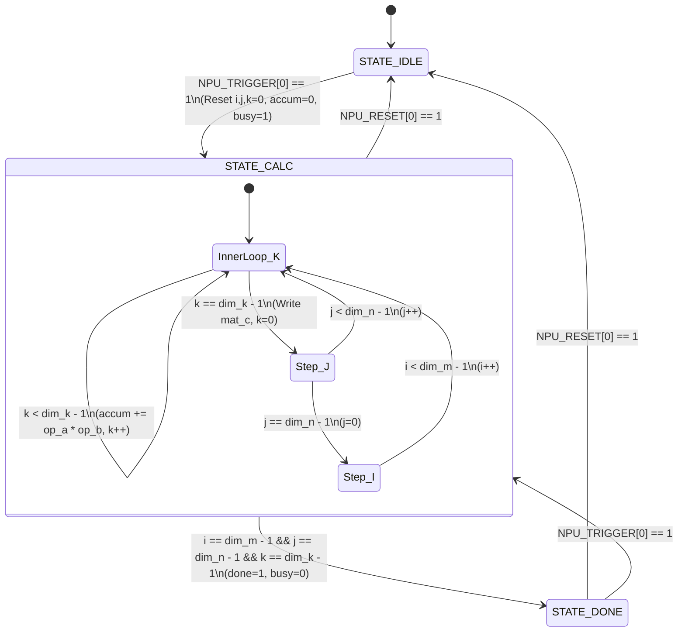

# Detailed Architecture of the Baseline NPU and the Superscalar Transformation Plan

> **Workspace:** `Superscalar/`  
> **Target Project:** `riscv-ai-accelerator`  
> **Document Purpose:** Complete technical explanation of the existing Neural Processing Unit (NPU) microarchitecture, followed by a component-by-component breakdown of what we are changing, where (exact files and RTL modules), and how to achieve an In-Order Dual-Issue Superscalar CPU & Accelerated NPU System.

---

## Table of Contents
1. [PART 1: In-Depth Architecture of Our Baseline NPU](#part-1-in-depth-architecture-of-our-baseline-npu)
   - 1.1 Overview & System-Level Role
   - 1.2 Memory-Mapped I/O (MMIO) Address Map
   - 1.3 Control & Status Registers (CSRs)
   - 1.4 Internal Dedicated SRAM Buffers (Tiles A, B, and C)
   - 1.5 Datapath & Arithmetic Compute Engine (MAC Unit)
   - 1.6 Finite State Machine (FSM) Lifecycle
   - 1.7 CPU-to-NPU Memory Bus Interconnect
   - 1.8 Software Driver Interaction & Polling Protocol
   - 1.9 Performance Profile & Baseline Bottlenecks
2. [PART 2: What We Are Changing, Where, and How to Make It Superscalar](#part-2-what-we-are-changing-where-and-how-to-make-it-superscalar)
   - 2.1 Architectural Paradigm: In-Order Dual-Issue Superscalar
   - 2.2 Change 1: Instruction Fetch & Dynamic Alignment Logic (IF)
   - 2.3 Change 2: Register File & Dynamic Issue Hazard Scanner (ID)
   - 2.4 Change 3: Dual ALUs & Intra-Cycle Bypass Forwarding (EX)
   - 2.5 Change 4: True Dual-Port Memory & MemClass Arbiter (MEM)
   - 2.6 Change 5: NPU Multi-Bank Streaming & Co-Issued Tile Transfers
   - 2.7 Change 6: Ping-Pong Double Buffering for Overlapped Compute
   - 2.8 Change 7: Asynchronous Command FIFO & Non-Blocking Execution
3. [Summary Matrix: Baseline vs. Superscalar Comparison](#summary-matrix-baseline-vs-superscalar-comparison)
4. [File Inventory & Implementation Map](#file-inventory--implementation-map)

---

# PART 1: In-Depth Architecture of Our Baseline NPU

The baseline Neural Processing Unit (implemented in [`converting_into_NPU/rtl/npu_top.sv`](file:///home/enovo/riscv-ai-accelerator/converting_into_NPU/rtl/npu_top.sv)) is a dedicated, memory-mapped hardware accelerator designed for General Matrix Multiply (GEMM) and tensor compute operations:
$$C_{M \times N} = A_{M \times K} \times B_{K \times N}$$
It accelerates matrix tiles up to $16 \times 16$ elements, where each matrix element is a 32-bit signed integer.

```text
       +-------------------------------------------------------------------------+
       |                  BASELINE SINGLE-ISSUE SYSTEM BUS                       |
       |  CPU Memory Stage (Addr[31:0], WriteData[31:0], WE, RE, ReadData[31:0])  |
       +------------------------------------+------------------------------------+
                                            |
                                            v
+=======================================================================================+
| NPU TOP MODULE (npu_top.sv) - MMIO Base: 0x8000_0000 - 0x8000_0CFC                    |
|                                                                                       |
|   +-------------------------------------------------------------------------------+   |
|   |                       MMIO Address Decoding & Bus Router                      |   |
|   |     - 0x8000_0000..0x8000_0020: Control & Status Registers (CSRs)            |   |
|   |     - 0x8000_0100..0x8000_04FC: Matrix A SRAM (256 x 32-bit words = 1 KB)     |   |
|   |     - 0x8000_0500..0x8000_08FC: Matrix B SRAM (256 x 32-bit words = 1 KB)     |   |
|   |     - 0x8000_0900..0x8000_0CFC: Matrix C SRAM (256 x 32-bit words = 1 KB)     |   |
|   +-------------------+--------------------+--------------------+-----------------+   |
|                       |                    |                    |                     |
|                       v                    v                    v                     |
|              +-----------------+  +-----------------+  +-----------------+            |
|              |   mat_a_sram    |  |   mat_b_sram    |  |   mat_c_sram    |            |
|              | (256 x 32-bit)  |  | (256 x 32-bit)  |  | (256 x 32-bit)  |            |
|              +--------+--------+  +--------+--------+  +--------^--------+            |
|                       |                    |                    |                     |
|                       |  a_calc_idx        |  b_calc_idx        | c_calc_idx          |
|                       |  {idx_i, idx_k}    |  {idx_k, idx_j}    | {idx_i, idx_j}      |
|                       v                    v                    | (Write Result)      |
|              +-----------------+  +-----------------+           |                     |
|              |      op_a       |  |      op_b       |           |                     |
|              +--------+--------+  +--------+--------+           |                     |
|                       \                    /                    |                     |
|                        v                  v                     |                     |
|                     +------------------------+                  |                     |
|                     | 32-bit Signed Multiplier|                 |                     |
|                     |   prod = op_a * op_b   |                  |                     |
|                     +-----------+------------+                  |                     |
|                                 |                               |                     |
|                                 v                               |                     |
|                     +------------------------+                  |                     |
|                     |    32-bit Accumulator  |                  |                     |
|                     | accum = (k==0?0:accum) | -----------------+                     |
|                     |         + prod         |                                        |
|                     +------------------------+                                        |
|                                 ^                                                     |
|                                 |                                                     |
|                     +-----------+------------+                                        |
|                     |   FSM & Index Counters |                                        |
|                     |  IDLE -> CALC -> DONE  |                                        |
|                     |  dim_m, dim_k, dim_n   |                                        |
|                     |  idx_i, idx_j, idx_k   |                                        |
|                     +------------------------+                                        |
+=======================================================================================+
```

---

## 1.1 Overview & System-Level Role
The baseline NPU functions as an **MMIO hardware coprocessor**. It does not fetch instructions from memory on its own. Instead:
- It connects to the CPU's pipeline at the **MEM stage**.
- When the CPU executes load (`lw`) or store (`sw`) instructions targeting addresses $\ge \text{0x8000\_0000}$, the core steers the access to the NPU instead of standard Data RAM.
- The host CPU configures matrix dimensions, writes raw matrix tiles into dedicated SRAMs, triggers the computation, polls the status register until completion, and reads back the computed output tile.

---

## 1.2 Memory-Mapped I/O (MMIO) Address Map
The NPU occupies a contiguous 4 KB physical address aperture from `0x8000_0000` to `0x8000_0CFC`:

| Address Range | Register / Buffer | Access | Description |
|---|---|:---:|---|
| `0x8000_0000` | `NPU_DIM_M` | R/W | Matrix dimension $M$ ($1 \le M \le 16$, default 16) |
| `0x8000_0004` | `NPU_DIM_K` | R/W | Matrix dimension $K$ ($1 \le K \le 16$, default 16) |
| `0x8000_0008` | `NPU_DIM_N` | R/W | Matrix dimension $N$ ($1 \le N \le 16$, default 16) |
| `0x8000_000C` | `NPU_TRIGGER` | W | Bit 0 = 1: Starts matrix multiplication FSM |
| `0x8000_0010` | `NPU_RESET` | W | Bit 0 = 1: Soft reset (restores IDLE, clears cycle counter) |
| `0x8000_0018` | `NPU_STATUS` | R | Bit 0 = `done`, Bit 1 = `busy` |
| `0x8000_0020` | `NPU_CYCLES` | R | 32-bit execution cycle counter |
| `0x8000_0100` – `0x8000_04FC` | `mat_a_sram` | R/W | Tile A Storage: 256 words $\times$ 32-bit (1 KB), index $(i \ll 4) + k$ |
| `0x8000_0500` – `0x8000_08FC` | `mat_b_sram` | R/W | Tile B Storage: 256 words $\times$ 32-bit (1 KB), index $(k \ll 4) + j$ |
| `0x8000_0900` – `0x8000_0CFC` | `mat_c_sram` | R/W | Tile C Storage: 256 words $\times$ 32-bit (1 KB), index $(i \ll 4) + j$ |

---

## 1.3 Control & Status Registers (CSRs)
The control logic uses 5-bit registers to track the dynamic tile dimensions:
- **`dim_m`**, **`dim_k`**, **`dim_n`**: If the software writes `0`, hardware defaults to `16` elements.
- **`NPU_TRIGGER`**: Writing `1` into bit 0 initiates the compute engine if it is in `STATE_IDLE` or `STATE_DONE`.
- **`NPU_RESET`**: Writing `1` into bit 0 clears counters, sets `state <= STATE_IDLE`, and resets `cycle_count <= 0`.
- **`NPU_STATUS`**: Returns `{30'd0, busy, done}`. Software reads this in a tight loop to detect job completion.
- **`NPU_CYCLES`**: Accumulates every clock cycle spent in `STATE_CALC`, allowing software to measure accelerator runtime.

---

## 1.4 Internal Dedicated SRAM Buffers
The accelerator contains three 1 KB on-chip word arrays:
```systemverilog
logic signed [31:0] mat_a_sram [0:255];
logic signed [31:0] mat_b_sram [0:255];
logic signed [31:0] mat_c_sram [0:255];
```
- Each SRAM stores up to $16 \times 16 = 256$ signed 32-bit integers.
- Because matrices are stored in standard row-major layout with a fixed pitch of 16 words:
  - Element $A(i, k)$ is mapped to word index: $\text{idx}_A = (i \times 16) + k = \{i[3:0], k[3:0]\}$
  - Element $B(k, j)$ is mapped to word index: $\text{idx}_B = (k \times 16) + j = \{k[3:0], j[3:0]\}$
  - Element $C(i, j)$ is mapped to word index: $\text{idx}_C = (i \times 16) + j = \{i[3:0], j[3:0]\}$
- Address decoding logic maps CPU byte addresses directly to SRAM word indices using bit subtraction:
  ```systemverilog
  assign diff_a = addr[11:0] - 12'h100;
  assign sram_a_word_idx = diff_a[9:2]; // 8-bit index (0 to 255)
  ```

---

## 1.5 Datapath & Arithmetic Compute Engine (MAC Unit)
The execution datapath consists of a signed 32-bit Multiply-Accumulate (MAC) pipeline:
1. **Parallel Operand Extraction**:
   ```systemverilog
   assign op_a = mat_a_sram[a_calc_idx];
   assign op_b = mat_b_sram[b_calc_idx];
   ```
2. **Combinational Multiplication**:
   ```systemverilog
   assign prod = op_a * op_b; // 32-bit signed product
   ```
3. **Accumulation & Boundary Reset**:
   ```systemverilog
   assign current_accum = (idx_k == 5'd0 ? 32'sd0 : accum) + prod;
   ```
   - When starting a new dot-product ($k = 0$), the previous accumulation is discarded without requiring a dead cycle.
   - For subsequent steps ($k > 0$), `prod` is added to the running sum `accum`.
4. **Throughput**: Performs **1 MAC per clock cycle**. For a full $16 \times 16 \times 16$ tile, the engine finishes in exactly **4,096 cycles**.

---

## 1.6 Finite State Machine (FSM) Lifecycle
The engine is driven by a 3-state sequential controller:



1. **`STATE_IDLE` (2'b00)**:
   - Waits for CPU write to `NPU_TRIGGER` (`0x8000_000C`).
   - Asserts `busy = 0`, `done = 0`.
2. **`STATE_CALC` (2'b01)**:
   - Asserts `busy = 1`, `done = 0`.
   - Iterates nested indices: $k$ (fastest, $0 \dots K-1$), $j$ (middle, $0 \dots N-1$), $i$ (slowest, $0 \dots M-1$).
   - When $k = \text{dim\_k} - 1$, the dot product for cell $C[i, j]$ is complete:
     ```systemverilog
     mat_c_sram[c_calc_idx] <= current_accum;
     accum <= 32'sd0;
     idx_k <= 5'd0;
     ```
   - When all $M \times N \times K$ multiply-accumulates finish, transitions to `STATE_DONE`.
3. **`STATE_DONE` (2'b10)**:
   - Asserts `done = 1`, `busy = 0`.
   - Result matrix remains stored in `mat_c_sram` for host read-out.

---

## 1.7 CPU-to-NPU Memory Bus Interconnect
In [`converting_into_NPU/rtl/rv32i_pipeline_stallbranch_core.sv`](file:///home/enovo/riscv-ai-accelerator/converting_into_NPU/rtl/rv32i_pipeline_stallbranch_core.sv), the CPU and NPU are coupled at the **MEM stage**:
```systemverilog
// Memory stage address decoding
assign is_npu_addr = (ex_mem_alu_result >= 32'h8000_0000);

assign ram_we = ex_mem_mem_write && !is_npu_addr;
assign npu_we = ex_mem_mem_write &&  is_npu_addr;

assign ram_re = ex_mem_mem_read  && !is_npu_addr;
assign npu_re = ex_mem_mem_read  &&  is_npu_addr;

assign mem_dmem_read_data = is_npu_addr ? npu_read_data : ram_read_data;
```
- If the instruction in MEM is targeting $< \text{0x8000\_0000}$, `data_memory.sv` is strobed.
- If $\ge \text{0x8000\_0000}$, `npu_top.sv` is strobed.
- Both share the exact same 32-bit write data bus (`dmem_store_data`) and return data into the MEM/WB pipeline register.

---

## 1.8 Software Driver Interaction & Polling Protocol
Software uses helper routines defined in `converting_into_NPU/sw/npu_driver.h`:
```c
// 1. Write tile dimensions
write_npu_reg(NPU_DIM_M, 16);
write_npu_reg(NPU_DIM_K, 16);
write_npu_reg(NPU_DIM_N, 16);

// 2. Stream Matrix A & B tiles into NPU SRAMs (sequential word stores)
for (int i = 0; i < 256; i++) {
    write_npu_mem(NPU_MAT_A_BASE + (i * 4), tile_a[i]);
    write_npu_mem(NPU_MAT_B_BASE + (i * 4), tile_b[i]);
}

// 3. Trigger hardware computation
npu_trigger();

// 4. Synchronous spin-lock polling loop
while (!npu_is_done()) {
    // CPU stalls in tight assembly loop checking NPU_STATUS register
}

// 5. Read back computed output tile
for (int i = 0; i < 256; i++) {
    tile_c[i] = read_npu_mem(NPU_MAT_C_BASE + (i * 4));
}
```

---

## 1.9 Performance Profile & Baseline Bottlenecks
While the baseline NPU achieves an **8.3x end-to-end speedup** over scalar software execution for $32 \times 32$ tiled GEMM (reducing execution from 122,548 cycles to 14,732 cycles), the system faces several severe throughput limits:
1. **Single-Issue CPU Stalling**: The single-issue core can only transfer 1 word per cycle. Transferring Tile A (256 words) and Tile B (256 words) takes at least $512$ store instructions, plus index calculation and loop overhead, consuming over **1,200 cycles**.
2. **Serial Tile Transfers**: Tile A and Tile B must be loaded one after the other because there is only one 32-bit memory bus port.
3. **Compute/Transfer Serialization**: The CPU cannot stream the next tile while the NPU is computing because there is only one set of SRAM buffers (`mat_a_sram`, `mat_b_sram`). Compute and memory transfers are strictly sequential.
4. **Busy-Wait Spin Polling**: The CPU wastes thousands of cycles executing `lw` and `bne` instructions polling `NPU_STATUS`, preventing it from doing useful work in parallel.

---

# PART 2: What We Are Changing, Where, and How to Make It Superscalar

To break through the scalar performance ceiling, we transform both the **CPU core** and the **NPU accelerator** into an **In-Order Dual-Issue (2-Way) Superscalar Architecture**.

```text
===================================================================================================
                                2-WAY SUPERSCALAR RISC-V SoC
===================================================================================================

  +----------------------- 2-WAY DUAL-ISSUE RV32I CORE -------------------------+
  |                                                                             |
  |  [IF Stage]      64-bit Dual Instruction Fetch + 128-entry BTB              |
  |                       |                                                     |
  |  [ID Stage]      Dual Decoders + Dynamic In-Order Issue Unit                |
  |                  4R/2W Register File (Age-priority WAW resolution)          |
  |                       |                                                     |
  |  [EX Stage]      Dual ALUs (ALU0 & ALU1)                                    |
  |                  Full Crossbar Forwarding + Intra-Cycle ALU0->ALU1 Bypass   |
  |                       |                                                     |
  |  [MEM Stage]     Dual Memory Ports + MemClass Structural Arbiter            |
  |                       |                      |                              |
  +-----------------------|----------------------|------------------------------+
                          |                      |
             Pipe 0 Bus   |                      | Pipe 1 Bus
             (Slot 0)     v                      v (Slot 1)
  +-----------------------------------------------------------------------------+
  |                   DUAL-PORT CROSSBAR & MEMORY INTERCONNECT                  |
  +-----------------------------------------------------------------------------+
                 |                                          |
                 v                                          v
  +------------------------------+       +--------------------------------------+
  |    DUAL-PORT DATA MEMORY     |       |       SUPERSCALAR NPU ENGINE         |
  |                              |       |                                      |
  | - Port 0: Read/Write 32-bit  |       | - Dual-Channel Multi-Bank Streaming  |
  | - Port 1: Read/Write 32-bit  | <===> | - Ping-Pong Double-Buffered SRAMs    |
  | - Simultaneous dual accesses |       | - 4-Entry Non-Blocking Command FIFO  |
  +------------------------------+       | - 16x16 Parallel Compute Core        |
                                         +--------------------------------------+
===================================================================================================
```

---

## 2.1 Architectural Paradigm: In-Order Dual-Issue Superscalar
- **Architecture Model**: **In-Order Dual-Issue (2-Way)** superscalar processor.
- **Why In-Order?**
  - Out-of-Order (OoO) engines require complex Reservation Stations, Reorder Buffers (ROB), Register Renaming Tables (RAT), and multi-ported CAMs, requiring massive silicon area and power overhead.
  - In scientific and machine learning workloads, **matrix multiplication is statically predictable and loop-dominated**.
  - As proven by our baseline sweeps in `RISCV_CPU`, an in-order dual-issue core with multi-bank streaming achieves **1.96x speedup (over 98% of the theoretical 2.0x maximum)** at a tiny fraction of the hardware cost.

---

## 2.2 Change 1: Instruction Fetch & Dynamic Alignment Logic (IF)

### WHERE:
- [`Superscalar/rtl/pc_superscalar.sv`](file:///home/enovo/riscv-ai-accelerator/Superscalar/rtl/pc_superscalar.sv)
- [`Superscalar/rtl/instruction_memory_64.sv`](file:///home/enovo/riscv-ai-accelerator/Superscalar/rtl/instruction_memory_64.sv)
- [`Superscalar/rtl/btb_128.sv`](file:///home/enovo/riscv-ai-accelerator/Superscalar/rtl/btb_128.sv)
- [`Superscalar/rtl/fetch_unit_superscalar.sv`](file:///home/enovo/riscv-ai-accelerator/Superscalar/rtl/fetch_unit_superscalar.sv)

### WHAT:
- Upgraded the 32-bit single-word instruction fetch interface to a **64-bit dual-word fetch bus**.
- Added a **128-entry Branch Target Buffer (BTB)** with 2-bit saturating counters.
- Built **dynamic unaligned word steering logic**.

### HOW:
1. **64-bit Fetch**: The instruction memory returns two 32-bit words per cycle: `imem_data[63:0]`.
2. **Unaligned Word Steering**:
   - If PC is 64-bit aligned (`pc[2] == 0`):
     - `slot0_instr = imem_data[31:0]`
     - `slot1_instr = imem_data[63:32]`
     - Both instructions issue concurrently; `next_pc = pc + 8`.
   - If PC is word-unaligned (`pc[2] == 1`), for instance after a branch jumps to an odd 32-bit word address:
     - The odd word (`imem_data[63:32]`) is steered into **Slot 0**.
     - **Slot 1 is padded with a NOP** (`32'h0000_0013`).
     - `next_pc = pc + 4`, realigning the PC onto a 64-bit boundary for all subsequent cycles.
3. **Speculative Branching**: The BTB checks `pc` in the IF stage. If a branch is predicted taken, `next_pc` redirects immediately to `target_pc` with **0 bubble cycles**.

---

## 2.3 Change 2: Register File & Dynamic Issue Hazard Scanner (ID)

### WHERE:
- [`Superscalar/rtl/register_file_4r2w.sv`](file:///home/enovo/riscv-ai-accelerator/Superscalar/rtl/register_file_4r2w.sv)
- [`Superscalar/rtl/control_superscalar.sv`](file:///home/enovo/riscv-ai-accelerator/Superscalar/rtl/control_superscalar.sv)
- [`Superscalar/rtl/imm_gen_superscalar.sv`](file:///home/enovo/riscv-ai-accelerator/Superscalar/rtl/imm_gen_superscalar.sv)
- [`Superscalar/rtl/hazard_unit_superscalar.sv`](file:///home/enovo/riscv-ai-accelerator/Superscalar/rtl/hazard_unit_superscalar.sv)

### WHAT:
- Upgraded the register file from 2 Read / 1 Write (2R/1W) ports to **4 Read / 2 Write (4R/2W) ports**.
- Built a dynamic in-order **issue hazard scanner (`hazard_scan`)**.
- Introduced **`MemClass`** instruction decoding.

### HOW:
1. **4R/2W Register File**:
   - Provides 4 asynchronous read ports (`rdata0_rs1`, `rdata0_rs2`, `rdata1_rs1`, `rdata1_rs2`) so two instructions can read all operands simultaneously.
   - Synchronously writes two results (`wdata0`, `wdata1`) on `posedge clk`.
   - **Internal Write-to-Read Bypass**: If an instruction reads a register being written in the same cycle, data is bypassed internally.
   - **WAW Collision Arbitration**: If both write ports target the same destination register ($rd_0 == rd_1$), **Slot 1 takes priority** because it is later in program order.
2. **Dynamic Issue Hazard Scanner**:
   Determines whether Slot 1 can co-issue alongside Slot 0 ($m = 2$) or whether Slot 0 must issue alone ($m = 1$):
   - **Intra-Packet RAW Detection**: Checks if Slot 1 reads Slot 0's destination register ($rd_0 == rs1_1 \lor rd_0 == rs2_1$). If dependent, Slot 1 is held in decode, and Slot 0 issues alone.
   - **Control Hazard Restriction**: If Slot 0 is an unconditional branch/jump (`JAL`, `JALR`), Slot 1 is not issued.
   - **Inter-Stage Load-Use Stall**: If an instruction in EX or MEM is a load and its destination matches an operand in ID, both slots are stalled for 1 cycle.
3. **MemClass Classification**:
   Instructions are categorized into 4 hardware resource classes:
   - `MEM_NONE`: Pure ALU / branch ops (consume 0 memory bus ports).
   - `MEM_STORE`: Scalar stores (`sw`) and NPU tile stores (`store_c`).
   - `MEM_BANK_A`: NPU Matrix A SRAM loads (`load_a`).
   - `MEM_BANK_B`: NPU Matrix B SRAM loads (`load_b`).

---

## 2.4 Change 3: Dual ALUs & Intra-Cycle Bypass Forwarding (EX)

### WHERE:
- `Superscalar/rtl/alu_superscalar.sv` (Phase 3)
- `Superscalar/rtl/forwarding_unit_superscalar.sv` (Phase 3)
- `Superscalar/rtl/branch_evaluator.sv` (Phase 3)

### WHAT:
- Added a second full 32-bit ALU (`alu1`) so both execution pipelines can compute arithmetic in parallel.
- Expanded forwarding into a full **$4 \times 6$ crossbar matrix**.
- Implemented **Intra-Cycle ALU0-to-ALU1 Forwarding**.

### HOW:
1. **Dual Execution Pipes**:
   - Pipe 0 executes all RV32I arithmetic, branches, jumps, loads, and stores.
   - Pipe 1 executes all RV32I arithmetic, loads, and stores in parallel.
2. **Intra-Cycle Forwarding (Breaking the Pointer Bottleneck)**:
   In baseline code, pointer arithmetic immediately precedes memory accesses:
   ```assembly
   addi a5, a5, 64    # Slot 0: Computes address in a5
   sw   t0, 0(a5)     # Slot 1: Stores data to address in a5 (RAW dependency!)
   ```
   Without intra-cycle forwarding, Slot 1 would stall. Our design feeds `alu0_result` directly into `alu1_operand` within the same clock cycle, allowing address arithmetic and store/load execution to **co-issue in the exact same cycle**.

---

## 2.5 Change 4: True Dual-Port Memory & MemClass Arbiter (MEM)

### WHERE:
- `Superscalar/rtl/data_memory_dualport.sv` (Phase 4)
- `Superscalar/rtl/mem_class_arbiter.sv` (Phase 4)

### WHAT:
- Upgraded single-port Data RAM to a **true dual-port memory system** (Port A and Port B).
- Added an arbitration unit based on `MemClass`.

### HOW:
1. **Dual Independent Ports**:
   - Port 0 connects to Pipeline 0; Port 1 connects to Pipeline 1.
   - Each port has independent 32-bit address, write data, write enable, and byte-mask lines.
2. **Arbitration Rules**:
   - **Load + Load**: Both read simultaneously from dual ports without stall.
   - **Store + Store**: Serialized (Port 0 completes in cycle $T$, Port 1 completes in cycle $T+1$).
   - **Store + Load (Distinct addresses)**: Parallel execution supported.
   - **Store + Load (Same address)**: Direct Store-to-Load forwarding within the MEM stage.
   - **ALU + Memory**: Always executes concurrently with 0 contention.

---

## 2.6 Change 5: NPU Multi-Bank Streaming & Co-Issued Tile Transfers

### WHERE:
- `Superscalar/rtl/npu_top_superscalar.sv` (Phase 5)
- `Superscalar/rtl/rv32i_superscalar_npu_core.sv` (Phase 5)

### WHAT:
- Redesigned NPU internal SRAM interfaces with **independent dual-bank write ports**.
- Allowed `load_a` and `load_b` instructions to execute in the **exact same clock cycle**.

### HOW:
1. **Dedicated SRAM Access Ports**:
   - `mat_a_sram` connects to internal write Port A.
   - `mat_b_sram` connects to internal write Port B.
2. **Parallel Co-Issue**:
   - Because `load_a` is tagged as `MEM_BANK_A` and `load_b` is tagged as `MEM_BANK_B`, the hazard unit recognizes that they access physically distinct hardware banks.
   - In cycle $T$:
     - Pipe 0 reads word $k$ of Matrix A from Data RAM and writes it to `mat_a_sram`.
     - Pipe 1 reads word $k$ of Matrix B from Data RAM and writes it to `mat_b_sram`.
   - **Result**: Cuts tile transfer time by **50%**.

---

## 2.7 Change 6: Ping-Pong Double Buffering for Overlapped Compute

### WHERE:
- `Superscalar/rtl/npu_top_superscalar.sv` (Phase 5)

### WHAT:
- Replaced single 1 KB SRAM buffers with **Ping-Pong Double Buffers** ($2 \times \text{Bank A}$, $2 \times \text{Bank B}$, $2 \times \text{Bank C}$).
- Enabled concurrent DMA tile streaming while the hardware MAC engine computes.

### HOW:
1. **Bank Duplication**:
   - **Bank A0 & Bank B0**: Active compute buffers (connected to the MAC array).
   - **Bank A1 & Bank B1**: Shadow streaming buffers (connected to the memory bus).
2. **Timeline Overlapping**:
   While the MAC array computes Tile $N$ using Banks A0 and B0, the superscalar CPU streams Tile $N+1$ into Banks A1 and B1.
   
   ```text
   Time Step:   Cycle 0 ................. 4096 ................. 8192
   MAC Engine:  [ Compute Tile 0 (Bank 0) ] [ Compute Tile 1 (Bank 1) ] [ Compute Tile 2 (Bank 0) ]
   Memory Bus:  [ Stream Tile 1 (Bank 1)  ] [ Stream Tile 2 (Bank 0)  ] [ Stream Tile 3 (Bank 1)  ]
                |<---- Transfer Hidden --->| |<---- Transfer Hidden --->|
   ```
3. **Zero-Cycle Swap**:
   When computation finishes, a 1-cycle pointer swap flips the active and shadow bank pointers. Data transfer latency is **completely hidden behind computation**, pushing hardware compute utilization toward **100%**.

---

## 2.8 Change 7: Asynchronous Command FIFO & Non-Blocking Execution

### WHERE:
- `Superscalar/rtl/npu_top_superscalar.sv` (Phase 5)
- `Superscalar/sw/npu_driver_superscalar.h` (Phase 5/6)

### WHAT:
- Replaced blocking MMIO trigger registers and polling loops with a **4-Entry Command & Dispatch FIFO**.

### HOW:
1. **FIFO Interface**:
   - CPU pushes commands (`OP_LOAD_TILE_A`, `OP_LOAD_TILE_B`, `OP_START_GEMM`) into the queue.
   - As long as the FIFO is not full, the CPU writes the command and **immediately continues executing subsequent code without stalling**.
2. **Decoupled Completion Signaling**:
   - When GEMM computation finishes, the NPU asserts an interrupt line or sets an auto-clearing completion flag.
   - Eliminates CPU spin-lock polling on `NPU_STATUS`. The CPU can execute outer loop counter calculations, address pointer arithmetic, or activations in parallel.

---

# Summary Matrix: Baseline vs. Superscalar Comparison

| Feature / Subsystem | Baseline Architecture (`converting_into_NPU`) | Superscalar Architecture (`Superscalar/`) | Performance & Functional Benefit |
|---|---|---|---|
| **Issue Width** | Single-Issue ($n = 1$) | **Dual-Issue ($n = 2$) In-Order** | Up to **2.0 IPC** peak throughput |
| **Instruction Fetch Bus** | 32-bit single word | **64-bit dual word** | Fetches 2 instructions / cycle |
| **Branch Handling** | Always-Stall (2-cycle bubble) | **128-Entry BTB with 2-bit counters** | **0-bubble** branch execution |
| **Unaligned Branches** | Single-word fetches | **Dynamic word steering logic** | Steers odd target to Slot 0, realigns PC |
| **Register File Ports** | 2 Read / 1 Write (2R/1W) | **4 Read / 2 Write (4R/2W)** | Parallel operand reads and commits |
| **WAW Resolution** | Sequential writeback | **Age-priority arbitration** (Slot 1 overwrites Slot 0) | Maintains strict program order |
| **Execution Datapath** | 1 32-bit ALU | **2 32-bit ALUs (ALU0 & ALU1)** | Parallel arithmetic computation |
| **Forwarding Network** | EX/MEM $\to$ EX | **$4 \times 6$ crossbar + intra-cycle ALU0 $\to$ ALU1** | Co-issues dependent pointer arithmetic |
| **Data Memory** | Single 32-bit port | **True Dual-Port (Port A & Port B)** | Parallel loads and independent memory accesses |
| **Memory Hazards** | Handled by full stall | **`MemClass` Structural Arbiter** | Store/Load arbitration without pipeline flush |
| **NPU SRAM Buffers** | Single 1 KB banks (A, B, C) | **Ping-Pong Double Buffers ($2 \times$ A, B, C)** | **Hides 100% of tile transfer latency** |
| **Tile Streaming** | Serial `load_a` then `load_b` | **Concurrent `load_a` + `load_b` co-issue** | **2x faster** tile transfer bandwidth |
| **Job Dispatch** | Synchronous MMIO trigger | **4-entry Command FIFO** | Non-blocking execution; zero CPU wait |
| **Status Polling** | Tight busy-wait spin loop | **Interrupt / event flag** | Frees CPU to compute background tasks |

---

# File Inventory & Implementation Map

| File Path | Status | Role in Superscalar Architecture |
|---|:---:|---|
| [`Superscalar/PLAN.md`](file:///home/enovo/riscv-ai-accelerator/Superscalar/PLAN.md) | ✅ Complete | Master architectural plan, empirical sweeps, and 6-phase roadmap |
| [`Superscalar/README.md`](file:///home/enovo/riscv-ai-accelerator/Superscalar/README.md) | ✅ Complete | Directory guide, phase progress log, and test execution instructions |
| [`Superscalar/explanation.md`](file:///home/enovo/riscv-ai-accelerator/Superscalar/explanation.md) | ✅ Complete | This file: In-depth NPU architecture and superscalar transformation guide |
| [`Superscalar/rtl/register_file_4r2w.sv`](file:///home/enovo/riscv-ai-accelerator/Superscalar/rtl/register_file_4r2w.sv) | ✅ Complete | 4R/2W register file with internal bypassing and WAW age priority |
| [`Superscalar/rtl/instruction_memory_64.sv`](file:///home/enovo/riscv-ai-accelerator/Superscalar/rtl/instruction_memory_64.sv) | ✅ Complete | 64-bit dual-word instruction memory supporting byte/word alignment |
| [`Superscalar/rtl/btb_128.sv`](file:///home/enovo/riscv-ai-accelerator/Superscalar/rtl/btb_128.sv) | ✅ Complete | 128-entry Branch Target Buffer with 2-bit saturating counters |
| [`Superscalar/rtl/pc_superscalar.sv`](file:///home/enovo/riscv-ai-accelerator/Superscalar/rtl/pc_superscalar.sv) | ✅ Complete | Dual-issue PC generator (+4, +8, branch redirect, BTB redirect) |
| [`Superscalar/rtl/fetch_unit_superscalar.sv`](file:///home/enovo/riscv-ai-accelerator/Superscalar/rtl/fetch_unit_superscalar.sv) | ✅ Complete | Integrated dual fetch unit with dynamic odd-word steering logic |
| [`Superscalar/rtl/control_superscalar.sv`](file:///home/enovo/riscv-ai-accelerator/Superscalar/rtl/control_superscalar.sv) | ✅ Complete | Dual decoders extracting RV32I control signals & MemClass tags |
| [`Superscalar/rtl/imm_gen_superscalar.sv`](file:///home/enovo/riscv-ai-accelerator/Superscalar/rtl/imm_gen_superscalar.sv) | ✅ Complete | Dual immediate generator for I, S, B, U, J formats |
| [`Superscalar/rtl/hazard_unit_superscalar.sv`](file:///home/enovo/riscv-ai-accelerator/Superscalar/rtl/hazard_unit_superscalar.sv) | ✅ Complete | Dynamic in-order issue unit (`hazard_scan`), RAW, WAW, and load-use |
| `Superscalar/rtl/alu_superscalar.sv` | ⏳ Phase 3 | Dual 32-bit execution ALUs |
| `Superscalar/rtl/forwarding_unit_superscalar.sv` | ⏳ Phase 3 | Full $4 \times 6$ crossbar forwarding + intra-cycle ALU0 $\to$ ALU1 bypass |
| `Superscalar/rtl/pipeline_regs_superscalar.sv` | ⏳ Phase 3 | Dual pipeline registers (`IF/ID`, `ID/EX`, `EX/MEM`, `MEM/WB`) |
| `Superscalar/rtl/data_memory_dualport.sv` | ⏳ Phase 4 | True dual-port synchronous Data RAM |
| `Superscalar/rtl/mem_class_arbiter.sv` | ⏳ Phase 4 | Memory class collision detector and store-to-load forwarding |
| `Superscalar/rtl/npu_top_superscalar.sv` | ⏳ Phase 5 | Double-buffered concurrent NPU accelerator with 4-entry Command FIFO |
| `Superscalar/rtl/rv32i_superscalar_npu_core.sv` | ⏳ Phase 5 | Full system SoC top module integrating dual-issue core with superscalar NPU |

